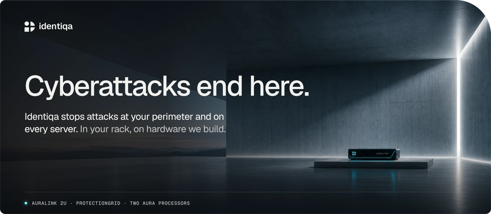
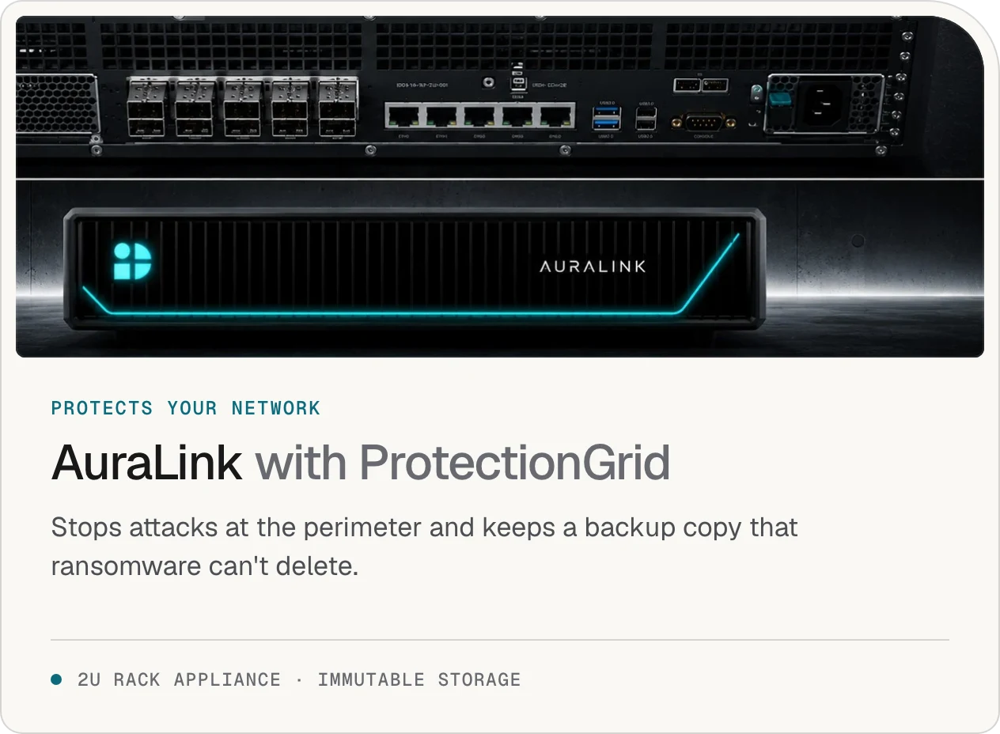
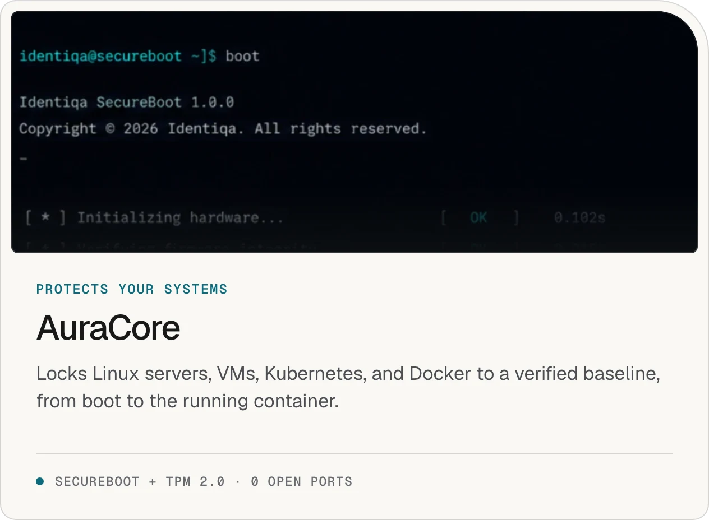
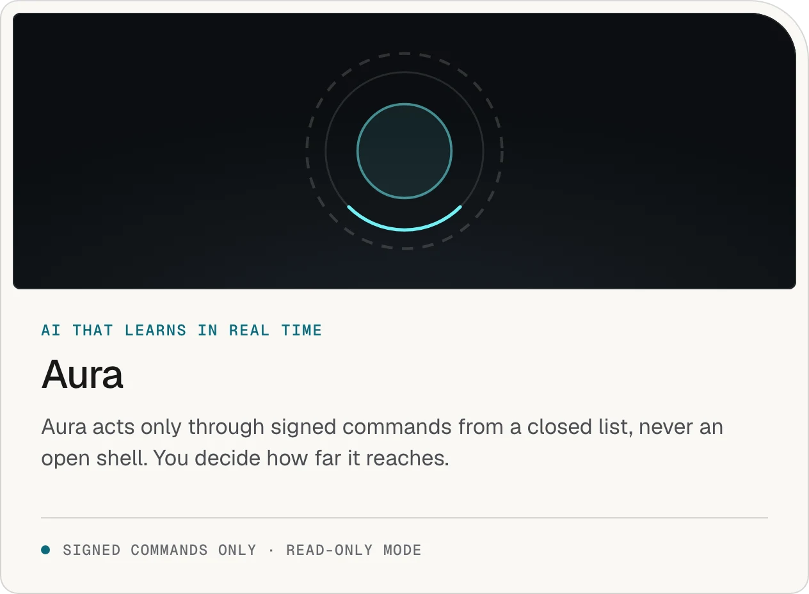
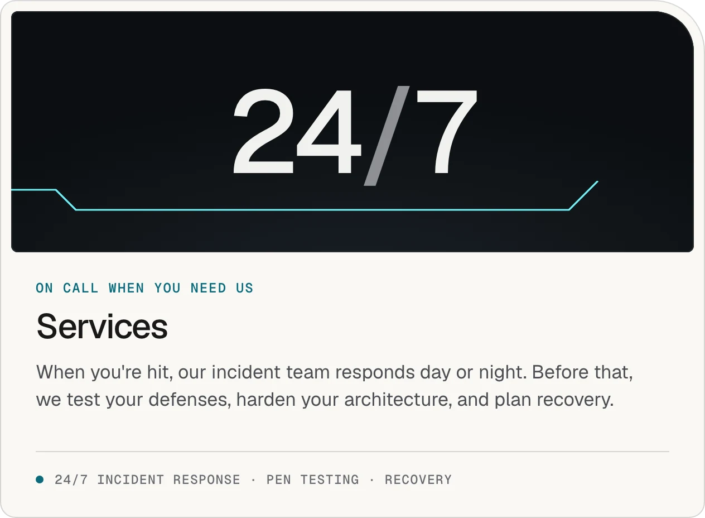

  

  <picture><source media="(prefers-color-scheme: dark)" srcset="https://raw.githubusercontent.com/get-identiqa/.github/main/profile/assets/card-auralink-dark.webp"></picture>
  <picture><source media="(prefers-color-scheme: dark)" srcset="https://raw.githubusercontent.com/get-identiqa/.github/main/profile/assets/card-auracore-dark.webp"></picture>

  <picture><source media="(prefers-color-scheme: dark)" srcset="https://raw.githubusercontent.com/get-identiqa/.github/main/profile/assets/card-aura-dark.webp"></picture>
  <picture><source media="(prefers-color-scheme: dark)" srcset="https://raw.githubusercontent.com/get-identiqa/.github/main/profile/assets/card-services-dark.webp"></picture>

Repositories we share with customers. Access is by invitation.

Found a vulnerability? Report it at [security.identiqa.com](https://security.identiqa.com/). We pay for valid findings.

[identiqa.com](https://www.identiqa.com)
